<div align="center">
  

# Estação Commit

**Toda missão começa com uma branch.**

Jogo de tabuleiro multiplayer para aprender e praticar o fluxo de trabalho com Git,<br>
do primeiro `git login` à **Pull Request**, contra amigos ou bots, direto no navegador.

[](https://www.php.net/)
[](https://laravel.com/)
[](https://react.dev/)
[](https://www.typescriptlang.org/)
[](https://inertiajs.com/)
[](https://neon.tech/)
[](https://render.com/)
[](LICENSE)

<br>

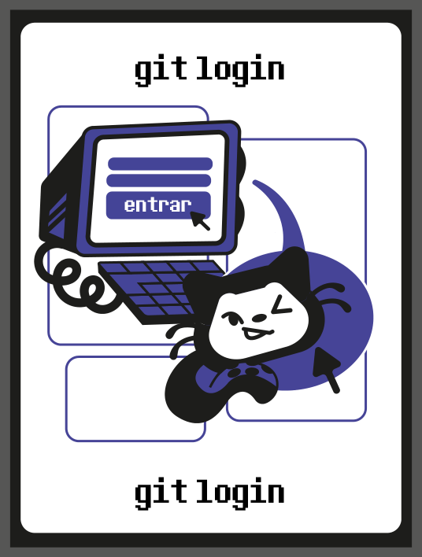
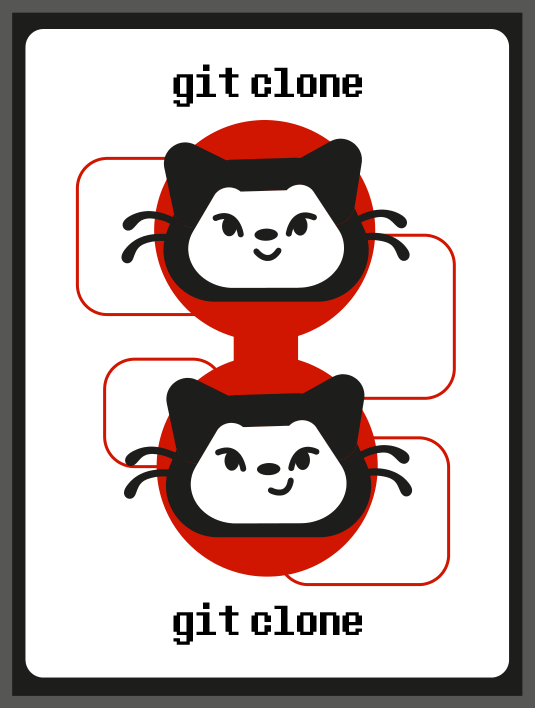
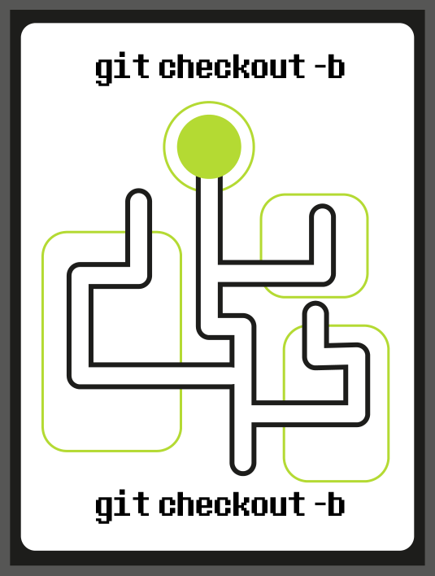
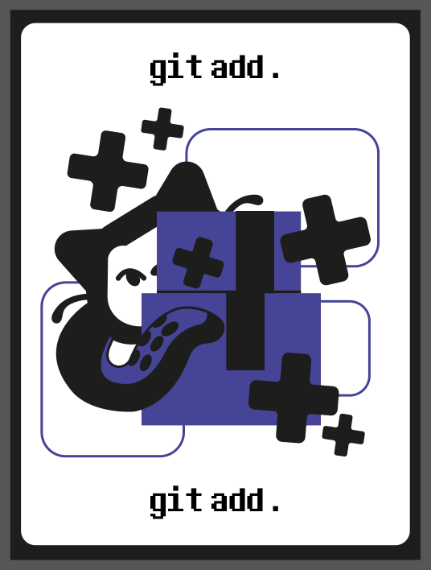
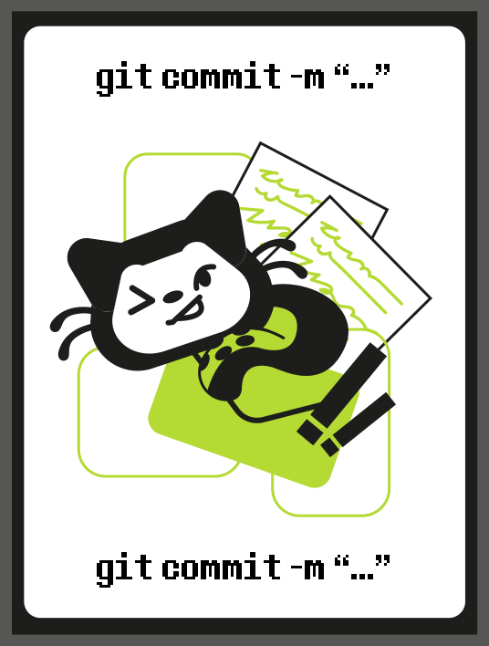
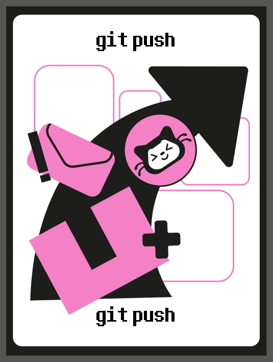
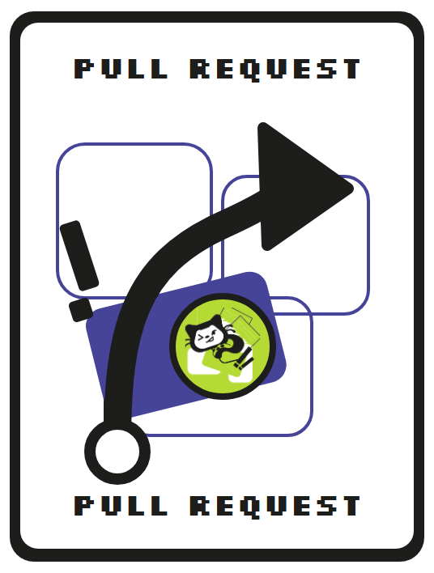

</div>

---

## Sumário

| | Seção | O que tem |
| :-: | --- | --- |
| 🎮 | [Como jogar](#como-jogar) | tabuleiro, galeria das cartas, turno, ataques e tutorial |
| ✨ | [Funcionalidades](#funcionalidades) | partida, bots, contas, e-mails, perfis, conquistas, ranking |
| 🧠 | [Bots e equilíbrio](#bots-e-equilíbrio) | como os bots decidem e o que as simulações mostraram |
| 🏗️ | [Tecnologias e arquitetura](#tecnologias-e-arquitetura) | stack, diagrama e estrutura de pastas |
| 🚀 | [Instalação e execução](#instalação-e-execução) | requisitos, comandos e desenvolvimento local |
| ⚙️ | [Configuração](#configuração) | variáveis de ambiente, tempo real e rotinas agendadas |
| 🧪 | [Testes e qualidade](#testes-e-qualidade) | suítes, paridade PHP × Worker e simulador |
| ☁️ | [Deploy e segurança](#deploy-e-segurança) | Docker, Render e práticas de segurança |
| 📝 | [O que mudou](#o-que-mudou) | resumo das entregas mais recentes |
| 👥 | [Autoria e créditos](#autoria-e-créditos) | quem criou o jogo e quem o levou para a web |

> 📚 **Toda a documentação** está em [`docs/README.md`](docs/README.md):
> [visão geral](docs/PROJETO.md) · [arquitetura](docs/ARQUITETURA.md) · [deploy no Render](docs/DEPLOY/RENDER.md) ·
> [variáveis de ambiente](docs/DEPLOY/VARIAVEIS-DE-AMBIENTE.md) · [rotinas agendadas](docs/DEPLOY/CRON-JOBS.md) ·
> [manutenção](docs/MANUTENCAO/GUIA-DE-MANUTENCAO.md) · [histórico](docs/MANUTENCAO/HISTORICO-DE-ALTERACOES.md) · [regras originais](docs/JOGO/)

---

## Como jogar

Cada partida tem **quatro participantes** (pessoas ou bots), jogando **um de cada vez**. Vence quem concluir primeiro o percurso de
**18 etapas** e jogar a **Pull Request**: a partida termina na hora. As regras oficiais (documento fechado, tabuleiro e cartas originais)
estão em [`docs/JOGO/`](docs/JOGO/), e a aplicação segue esse material.

<div align="center">
  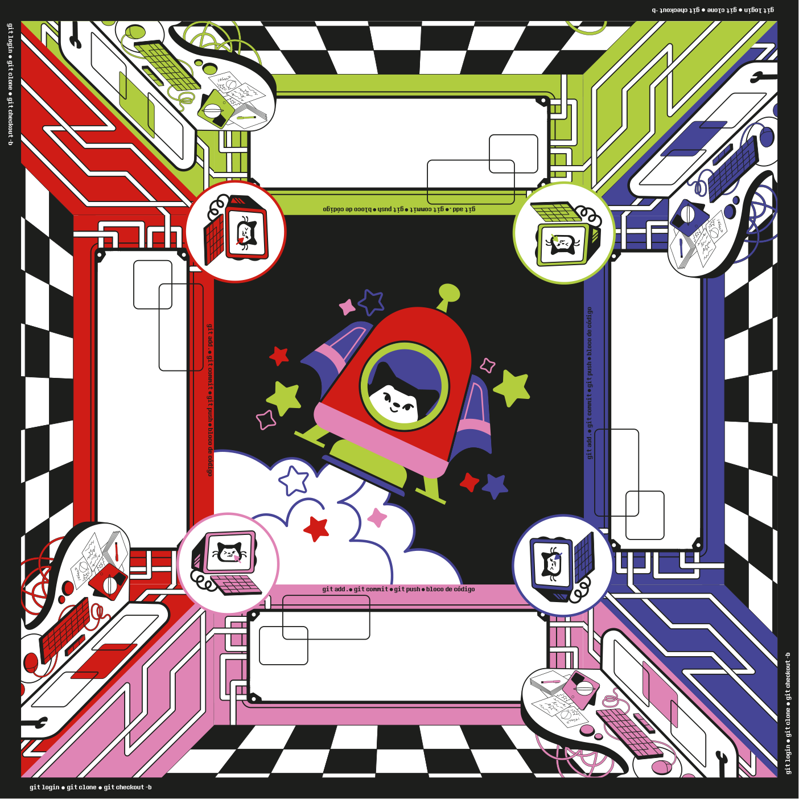
  <br><sub>O tabuleiro: cada jogador monta a própria trilha num lado da mesa.</sub>
</div>

### O percurso

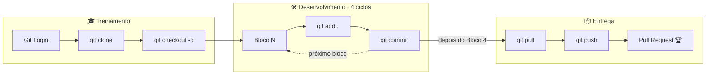

| Fase | Etapas | O que acontece |
| --- | --- | --- |
| 🎓 **Treinamento** (1 a 3) | `Git Login` → `git clone` → `git checkout -b` | única fase em que `Limpar Credenciais` funciona e em que `git pull` vira curinga |
| 🛠️ **Desenvolvimento** (4 a 15) | `Bloco N` → `git add .` → `git commit`, quatro vezes | os **Blocos de Código** são peças do tabuleiro, não cartas de compra |
| 📦 **Entrega** (16 a 18) | `git pull` → `git push` → `Pull Request` | a última etapa conclui a partida |

### As cartas

O baralho tem **83 cartas**. As 4 cópias de `Git Login` não entram na compra: **cada jogador começa com uma**, e sobram **67 cartas** para
comprar. A composição vem de [`config/game.php`](config/game.php), e a matemática por trás dela está em
[`docs/ARQUITETURA.md`, seção 12](docs/ARQUITETURA.md#12-baralho-matemática-e-justiça).

<table>
  <tr>
    <td align="center" width="14%"><br><b>Git Login</b><br><sub>4 · etapa 1</sub></td>
    <td align="center" width="14%"><br><b>git clone</b><br><sub>10 · etapa 2</sub></td>
    <td align="center" width="14%"><br><b>git checkout -b</b><br><sub>10 · etapa 3</sub></td>
    <td align="center" width="14%"><br><b>git add .</b><br><sub>18 · cada ciclo</sub></td>
    <td align="center" width="14%"><br><b>git commit</b><br><sub>18 · cada ciclo</sub></td>
    <td align="center" width="14%">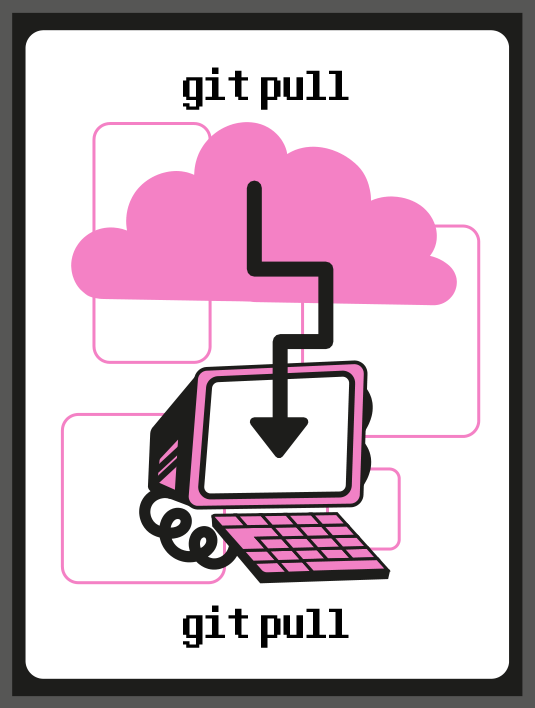<br><b>git pull</b><br><sub>6 · etapa 16</sub></td>
    <td align="center" width="14%"><br><b>git push</b><br><sub>8 · etapa 17</sub></td>
  </tr>
  <tr>
    <td align="center"><br><b>Pull Request</b><br><sub>5 · etapa 18 🏆</sub></td>
    <td align="center">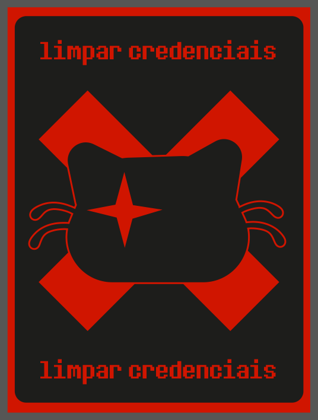<br><b>Limpar Credenciais</b><br><sub>2 · ataque</sub></td>
    <td align="center">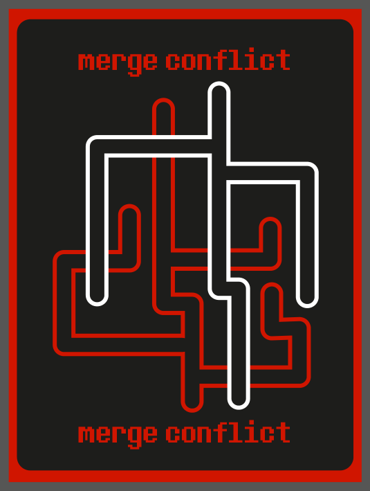<br><b>Merge Conflict</b><br><sub>2 · ataque</sub></td>
    <td align="center">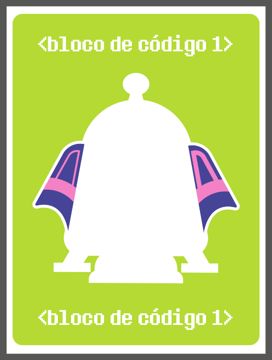<br><b>Bloco 1</b><br><sub>peça</sub></td>
    <td align="center">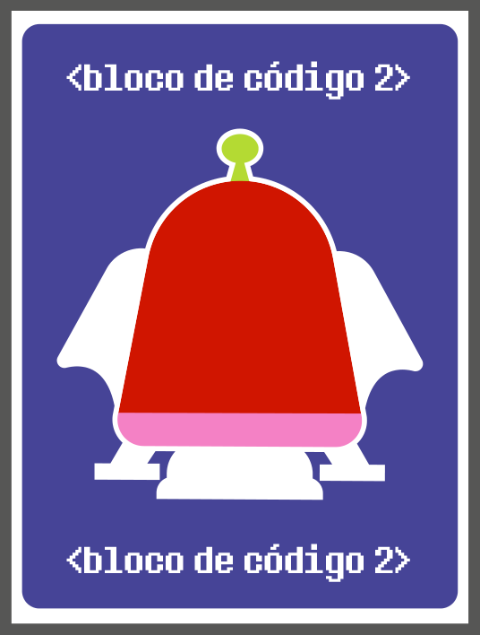<br><b>Bloco 2</b><br><sub>peça</sub></td>
    <td align="center">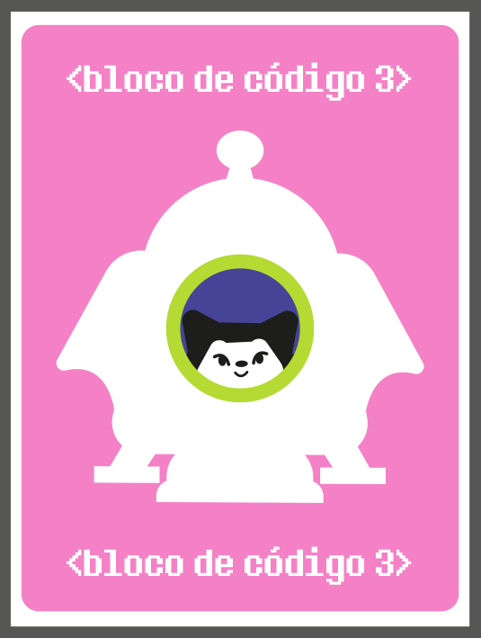<br><b>Bloco 3</b><br><sub>peça</sub></td>
    <td align="center">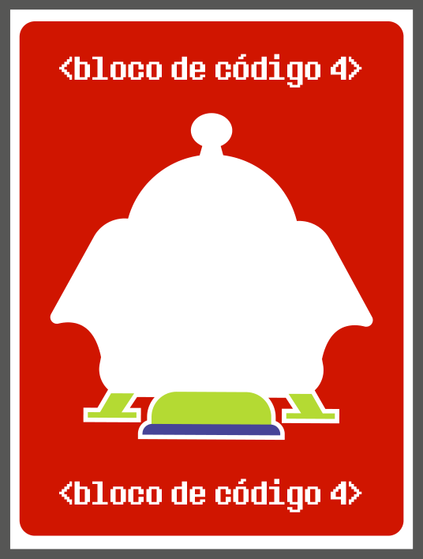<br><b>Bloco 4</b><br><sub>peça</sub></td>
  </tr>
</table>

<details>
<summary><b>📖 Detalhes de cada carta</b></summary>

<br>

- **Git Login.** Todos começam com ela, então ninguém depende do acaso para dar o primeiro passo.
- **git clone e git checkout -b.** As cartas mais disputadas do começo (10 cópias cada), em número maior de propósito para o Treinamento não virar espera.
- **git add . e git commit.** 18 cópias de cada para 16 necessárias na mesa (4 jogadores × 4 ciclos): sempre há folga. O `commit` libera o próximo bloco.
- **git pull.** Tem dois papéis: etapa da Entrega e **curinga no Treinamento** (quem ainda está nas etapas 1 a 3 pode usá-lo para comprar 2 cartas).
- **git push.** Só 8 cópias: são necessárias 4, e o excesso antigo (16) enchia o baralho de cartas quase mortas.
- **Pull Request.** Cinco cópias para quatro jogadores. Quem a joga **na ordem certa** encerra a partida e abre a tela de vitória.
- **Limpar Credenciais.** Só alcança quem ainda está no Treinamento: o alvo perde o que jogou e volta ao início.
- **Merge Conflict.** O alvo **perde a próxima vez**. Não acumula: um conflito por vez em cada jogador.
- **Blocos de Código.** Quatro peças com cor e arte próprias. Não são trocadas nem compradas: ao encaixar um, o seguinte é entregue; depois do Bloco 4 vem 1 carta comum.

A arte fica em [`public/images/estacao-commit/corrected/`](public/images/estacao-commit/corrected/) (PNG e WebP) e é desenhada por
[`GameCard.tsx`](resources/js/Components/GameCard.tsx). As cartas impressas originais estão em [`docs/JOGO/cartas.pdf`](docs/JOGO/cartas.pdf) e
[`docs/JOGO/extracartas.pdf`](docs/JOGO/extracartas.pdf); o tratamento das artes está descrito em
[`docs/JOGO/relatorio-refinamento-visual.md`](docs/JOGO/relatorio-refinamento-visual.md).

</details>

### Como é um turno

```mermaid
flowchart TD
    V([Sua vez · 25 s]) --> Q{Tem a carta<br>da próxima etapa?}
    Q -- sim --> J[Joga a carta<br>e compra 1]
    Q -- "é um Bloco" --> BL[Encaixa o Bloco]
    Q -- não --> X{Vale atacar?}
    X -- sim --> AT[Limpar Credenciais<br>ou Merge Conflict]
    X -- não --> TR[Troca 1 carta<br>de preferência uma marcada Sobrando]
    J --> H{Mais de 6<br>cartas comuns?}
    AT --> H
    H -- sim --> DS[Descarta o excesso]
    H -- não --> F([Passa a vez])
    DS --> F
    BL --> F
    TR --> F
```

1. **Mão inicial:** `Git Login`, 3 cartas comuns sorteadas e o **Bloco de Código** da vez.
2. **Na sua vez** (25 s para quem é humano) você faz **uma** ação: jogar a carta da próxima etapa (e comprar 1), encaixar o bloco, **trocar** uma carta (conta como a jogada) ou **atacar**.
3. **Dica de troca:** cartas que o seu percurso não usa mais aparecem marcadas como **Sobrando**. É a mesma conta que os bots fazem, só com a sua mão e a sua etapa.
4. **Limite da mão:** no máximo 6 cartas comuns; se passar, descarte o excesso.
5. **Tempo:** se os 25 s acabarem, a vez é pulada. Com **3 timeouts seguidos** o jogador sai e **um bot assume** com a mesma mão e o mesmo percurso.
6. **Bots** jogam um passo por vez, sem prazo. Se todos os humanos saírem, a sala é destruída.

> 🎓 **Tutorial "Você é um estagiário!".** Abre uma vez em cada partida nova, mas **espera a sua vez passar** para não fazer você perder rodadas.
> Se a sua vez chegar com ele aberto, aparece **"É a sua vez · Ns · Jogar agora"**. O botão *Como jogar* fica sempre disponível.

---

## Funcionalidades

<details open>
<summary><b>🎲 Partida e salas</b></summary>

<br>

- **Salas para quatro** criadas por um modal guiado: o anfitrião escolhe amigos e bots (até 3, catálogo em [`config/bots.php`](config/bots.php)).
- **Convites por código ou link.** Abrir o link já **entra sozinho na sala** ("Entrando na sala…"), com uma tentativa automática e botão *Tentar de novo* se algo falhar. O servidor revalida tudo dentro de uma transação com trava: convite expirado ou revogado, sala cheia, partida iniciada e corrida pela última vaga.
- **Jogadas seguras:** cada jogada leva um `action_uuid` (não conta duas vezes) e uma `version` (jogada fora de ordem recebe 409). O servidor é a única autoridade.
- **Relógio do servidor:** 25 s por vez humana; `games:sweep` resolve vezes paradas **mesmo com todas as páginas fechadas**.
- **Tela de partida sem rolagem no computador** (de 1024×768 a 1920×1080): o tabuleiro é o maior quadrado que cabe, as cartas crescem com a altura da janela dentro de um limite e o aviso de turno fica ao lado do tabuleiro.
- **Interface animada:** tabuleiro 3D, carta voando do baralho, bloco novo entrando, etiqueta de quem joga, registro da partida, seletor de alvo e tela de vitória. Respeita `prefers-reduced-motion`.
- **Saída e anfitrião:** o comando passa ao próximo humano; quem sai no meio da partida é substituído por um bot.
- **Limpeza automática** de salas vazias, expiradas e encerradas, sem perder resultados.

Detalhes: [`docs/ARQUITETURA.md`, seção 2](docs/ARQUITETURA.md#2-multiplayer).

</details>

<details>
<summary><b>🔐 Contas, login e e-mails</b></summary>

<br>

- **Cadastro e login** por e-mail e senha, com limite de tentativas, validação do nome e do domínio do e-mail.
- **Código de verificação de 6 dígitos** (opcional, `EMAIL_VERIFICATION`): a conta **só é criada depois do código**, guardado apenas como hash.
- **Entrar com Google:** o logo do Google aparece em tudo o que é ligado a ele (login, cadastro e Conta Google no perfil). Quem já tem conta com o mesmo e-mail entra direto.
- **Recuperação de senha** com e-mail da marca; trocar a senha encerra as outras sessões.
- **Contas temporárias (visitantes):** jogam sem cadastro, por cookie HttpOnly com token em hash, com prazo de inatividade e teto de dias.
- **Saída de emergência:** se entrar ou se cadastrar falhar por um erro inesperado do servidor, a tela oferece **"Jogar com perfil temporário"**. Ninguém fica parado sem caminho.

**E-mails enviados** (todos com a identidade visual do jogo, versão HTML e texto puro):

| E-mail | Quando | Quantas vezes |
| --- | --- | :-: |
| Código de verificação | cadastro por e-mail (se ligado) | a cada pedido de código |
| Recuperação de senha | "Esqueci minha senha" | a cada pedido |
| **Boas-vindas** (versão e-mail ou Google) | conta criada (com código: depois de confirmar) | **1 por conta** |
| **Conta Google vinculada** | Google ligado pelo perfil, ou primeiro login com Google numa conta de e-mail | **1 por vínculo** |
| *(nenhum)* | login comum ou com Google já vinculado | — |

Boas-vindas e "Google vinculado" são **cortesia**: uma única tentativa no Brevo. Se ele der erro (fora do ar, cota diária esgotada,
429), o e-mail simplesmente não é enviado e o login segue normalmente; o Resend fica guardado para o código e a recuperação de senha.
Dá para desligar esses dois com `MAIL_WELCOME=false`. Detalhes: [`docs/ARQUITETURA.md`, E-mail e resiliência](docs/ARQUITETURA.md#e-mail-e-resiliência).

</details>

<details>
<summary><b>👤 Perfis e comunidade</b></summary>

<br>

- **Perfil público** com avatar, capa, bio, links, moldura, fundo, título, selos de programação e o estado "jogando agora".
- **Edição em 5 seções numeradas** (Identidade · Foto · Banner e fundo · Conquistas, selo e título · Links), com atalhos no topo.
- **Fundos:** degradês e desenhos leves, incluindo fundos de espaço, e **fundos animados** em três níveis: **Premium** (10 vitórias),
  **Elite** (20) e **Lendário** (50). Só CSS: o banco guarda apenas o nome do fundo.
- **O card do topo é a prévia:** foto, capa, fundo e ícone mudam nele na hora, sem salvar; o botão *Editar perfil* leva direto à edição.
- **Compartilhar perfil:** painel com a prévia de um **story 9:16** (você escolhe o fundo e o que aparece), copiar link, baixar a imagem,
  compartilhar no celular, WhatsApp e X.
- **Foto e capa seguras:** checagem de conteúdo +18 no navegador (modelo aberto NSFWJS, baixado só quando alguém escolhe uma imagem)
  e recusa de GIF ou imagem animada no servidor.
- **Editor de capa** com prévia na mesma proporção da capa publicada: arrastar acompanha o cursor, zoom suave (slider, roda do mouse ou teclado), *Centralizar*, *Imagem inteira*, *Preencher*, *Redefinir* e um mapa da área visível. Capas antigas continuam iguais (zoom 100 = enquadramento anterior).
- **Conquistas em destaque dentro do card do perfil**, escolhidas num seletor no modo de edição. Só aparecem se a pessoa ligar a opção.
- **Seguir e deixar de seguir**, busca de jogadores, jogadores recomendados e selo de verificado.
- **Notificações** com sino, central de avisos e popup de conquista.
- **Imagens no banco** servidas como imagem cacheável em `/imagens/{tipo}/{usuário}?v=`.

</details>

<details>
<summary><b>🏅 Conquistas e ranking</b></summary>

<br>

- **11 conquistas** em SVG, de *Estrela Inicial* (no cadastro) a *Lenda da Estação* (100 vitórias), nos níveis inicial, bronze, prata, ouro, platina e lenda. Concedidas só pelo servidor e de forma idempotente. Catálogo: [seção 13](docs/ARQUITETURA.md#13-conquistas).
- **Ranking geral, semanal e mensal** no fuso `America/Sao_Paulo`. Só aparece quem tem pelo menos 1 vitória, ordenado por vitórias, derrotas e nome. O histórico fica em `match_results` mesmo depois que a sala é removida.

</details>

<details>
<summary><b>⚡ Desempenho, erros e operação</b></summary>

<br>

- WebSocket só conecta quando a página precisa; o Dashboard usa polling leve.
- Páginas de erro e de espera personalizadas (inclusive estáticas no Apache para 502/503/504), em português e sem texto técnico.
- Log operacional (`OpsLog`) sem dados pessoais: e-mails, falhas de provedor e eventos de jogo. Veja [observabilidade](docs/ARQUITETURA.md#8-observabilidade).
- Agendador leve (`scheduler-loop.sh`) que roda `schedule:run` a cada minuto, sem processo PHP residente.

</details>

---

## Bots e equilíbrio

Os bots seguem **as mesmas regras e a mesma compra de cartas** que as pessoas, e decidem **só com o que um jogador da mesa poderia saber**:
a própria mão e o estado público (etapa e percurso de cada um, quem está bloqueado). Nunca veem a mão dos outros, o baralho ou o descarte.

| O bot… | Como |
| --- | --- |
| joga a carta da vez | sempre que a tiver, ou encaixa o bloco |
| escolhe o que trocar | a carta que o percurso não usa mais, ou a cópia além do que falta; guarda a que vai usar antes |
| ataca | Merge Conflict só no líder perto do fim (etapa 12+); Limpar Credenciais só dentro da regra do Treinamento |
| desempata o alvo | quem joga logo depois dele (nenhum assento fixo é favorecido) |
| **hesita** (só com pessoas na mesa) | numa vez em que poderia avançar, às vezes troca uma carta em vez de jogar: 67% com 1 pessoa, 50% com 2, 40% com 3 |

A lógica existe em dois motores idênticos: [`app/Services/BotBrain.php`](app/Services/BotBrain.php) e [`worker/src/bot.ts`](worker/src/bot.ts),
com a paridade conferida por cenários compartilhados em [`tests/parity/`](tests/parity/).

**Decisão de produto: contra bots, o jogador real vence cerca de 90% das partidas.** Os bots não ganham cartas piores nem veem nada a
mais; eles só **hesitam** de vez em quando. O "sorteio" da hesitação é uma conta sobre turno, assento e etapa, igual no PHP e no Worker,
e não pode ser influenciado pelo navegador. Mesa só de bots não tem hesitação.

Resultado medido (3.000 partidas por cenário no motor real, com o simulador [`worker/sim/balance.ts`](worker/sim/balance.ts), grupo `final`):

| Mesa | Pessoas vencem (jogando casualmente) | Pessoas vencem (seguindo a dica **Sobrando**) |
| --- | :-: | :-: |
| 1 pessoa × 3 bots | 86,9% | 93,6% |
| 2 pessoas × 2 bots | 85,0% | 97,7% |
| 3 pessoas × 1 bot | ~86% (com 40%) | ~98% |

Sem a hesitação, o mesmo humano atento venceria ~25% (a parte justa) e o casual ~8%. Quem perde muitas vezes por tempo cai para 70–80%.
O baralho continua 100% aleatório. Análise completa:
[`docs/ARQUITETURA.md`, seção 17](docs/ARQUITETURA.md#17-equilíbrio-entre-humanos-e-bots-auditoria-e-simulações).

---

## Tecnologias e arquitetura

| Camada | Tecnologias |
| --- | --- |
| Backend | PHP 8.2+, Laravel 12, Eloquent, Sanctum, Socialite |
| Frontend | React 18, TypeScript 5, Inertia.js 2, Tailwind CSS 3, Framer Motion, Headless UI |
| Build | Vite 7 |
| Banco | PostgreSQL (Neon) em produção; SQLite nos testes |
| Tempo real | Laravel Reverb (padrão) ou Cloudflare Workers + Durable Objects (opcional) |
| E-mail | Brevo (API HTTPS), Resend como reserva |
| Login social | Google OAuth 2.0 |
| Execução | Docker, Apache, Supervisor, Render |
| Testes | PHPUnit 11, Node Test Runner, Vitest |

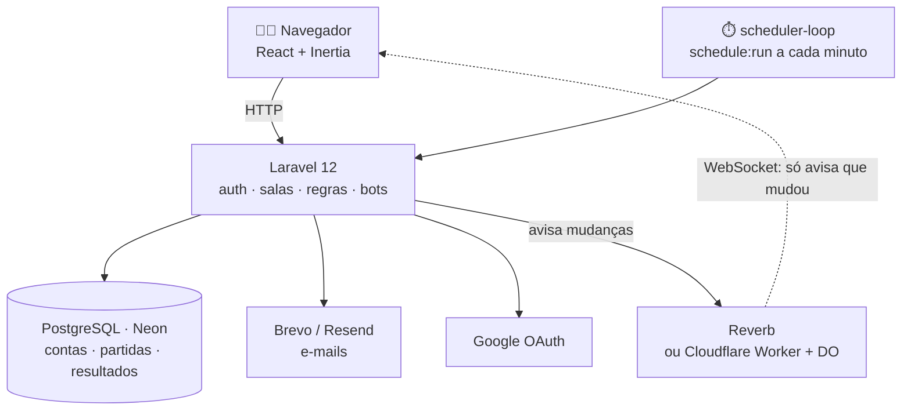

O estado do jogo é sempre do Laravel; o tempo real só avisa que algo mudou. Visão geral em [`docs/PROJETO.md`](docs/PROJETO.md).

<details>
<summary><b>📁 Estrutura do repositório</b></summary>

```text
app/
├── Console/Commands/       # limpeza, expiração, varredura de partidas e utilitários
├── Http/Controllers/       # páginas e ações HTTP
├── Http/Middleware/        # sessão, cabeçalhos de segurança, Inertia
├── Mail/                   # e-mails (código, boas-vindas, Google vinculado) e transportes Brevo/Resend
├── Models/                 # entidades Eloquent
├── Services/               # motor do jogo, BotBrain, salas, ranking, e-mails e tempo real
└── Support/                # identidade, avatares, bots, erros e utilitários
config/                     # bots, perfis, conquistas, verificação, jogo
database/migrations/        # esquema versionado
docs/                       # documentação (índice em docs/README.md; regras em docs/JOGO)
resources/
├── js/                     # componentes, layouts, páginas e bibliotecas do front
└── views/emails/           # modelos dos e-mails (HTML e texto)
routes/                     # web, autenticação, canais e agendador
tests/                      # Feature, Unit, js, parity
worker/                     # Cloudflare Worker + Durable Objects e o simulador de equilíbrio (worker/sim)
docker/                     # Apache, Supervisor, agendador e páginas de erro
```

</details>

---

## Instalação e execução

**Requisitos:** PHP 8.2+, Composer 2, Node.js 20+ (o simulador usa Node 22.18+), PostgreSQL 14+ (ou Neon) e Git.
O Docker reproduz o ambiente de produção.

```bash
git clone https://github.com/guisouzsa/estacao-commit-game.git
cd estacao-commit-game
composer install
cp .env.example .env          # no PowerShell: Copy-Item .env.example .env
php artisan key:generate
npm install
php artisan migrate
npm run build
```

Atalho: `composer run setup` faz tudo isso, desde que o `.env` aponte para um PostgreSQL disponível.

```bash
composer run dev          # Laravel em http://127.0.0.1:8001, fila e Vite
php artisan reverb:start  # tempo real local, se usar Reverb
```

<details>
<summary><b>🛠️ Comandos úteis</b></summary>

```bash
php artisan optimize:clear                  # limpa caches
php artisan player:create-test teste --email=teste@example.com --password="uma-senha-com-12-ou-mais-caracteres"
php artisan rooms:expire-waiting            # rotinas manuais
php artisan rooms:purge-finished
php artisan games:sweep
php artisan guests:prune
```

Os scripts em `database/manual-sql/` são administrativos: leia cada arquivo e faça backup antes. Guia completo:
[`docs/DESENVOLVIMENTO/INSTALACAO-LOCAL.md`](docs/DESENVOLVIMENTO/INSTALACAO-LOCAL.md).

</details>

---

## Configuração

A referência de **todas** as variáveis está em [`docs/DEPLOY/VARIAVEIS-DE-AMBIENTE.md`](docs/DEPLOY/VARIAVEIS-DE-AMBIENTE.md).
Como trocar hospedagem, banco, e-mail ou Google: [`docs/MANUTENCAO/GUIA-DE-MANUTENCAO.md`](docs/MANUTENCAO/GUIA-DE-MANUTENCAO.md).

| Grupo | Variáveis principais | Obrigatório |
| --- | --- | :-: |
| Aplicação | `APP_KEY`, `APP_URL` | sim |
| Banco | `DB_HOST`, `DB_DATABASE`, `DB_USERNAME`, `DB_PASSWORD` | sim |
| Tempo real (Reverb) | `REVERB_APP_ID`, `REVERB_APP_KEY`, `REVERB_APP_SECRET`, `VITE_REVERB_*` | sim |
| E-mail | `MAIL_MAILER`, `BREVO_API_KEY`, `MAIL_FROM_ADDRESS`, `EMAIL_VERIFICATION`, `MAIL_WELCOME` | opcional |
| Login com Google | `GOOGLE_CLIENT_ID`, `GOOGLE_CLIENT_SECRET`, `GOOGLE_REDIRECT_URI` | opcional |
| Cloudflare | `REALTIME_*`, `GAME_ENGINE`, `GAME_ENGINE_PARITY_ACK` | opcional |

> 🔒 Nunca versione `.env`, `.dev.vars`, dumps ou capturas com chaves, e nunca coloque segredos em variáveis `VITE_*`.

**Tempo real.** *Opção A, Reverb (padrão):* roda no mesmo contêiner, com o Apache encaminhando `/app/`. *Opção B, Cloudflare:* o
[`worker/`](worker/) tem WebSocket Hibernation, tokens HMAC de uso único e um motor de partidas opcional, que só liga com `GAME_ENGINE=cloudflare`
**e** `GAME_ENGINE_PARITY_ACK` igual à versão de paridade atual. Quando uma regra ou os bots mudam, a versão sobe e a liberação antiga
deixa de valer sozinha, e o jogo volta ao motor PHP. Detalhes: [`docs/DEPLOY/CLOUDFLARE.md`](docs/DEPLOY/CLOUDFLARE.md).

**Rotinas agendadas** (sem worker de fila; detalhes em [`docs/DEPLOY/CRON-JOBS.md`](docs/DEPLOY/CRON-JOBS.md)):

| Frequência | Comando | Finalidade |
| --- | --- | --- |
| a cada minuto | `rooms:expire-waiting` | remove salas vazias após o prazo |
| a cada minuto | `rooms:purge-finished` | remove salas encerradas, preservando resultados |
| a cada minuto | `games:sweep` | resolve vezes paradas, mesmo sem ninguém na página |
| a cada 15 minutos | `guests:prune` | remove visitantes inativos que não estão jogando |

---

## Testes e qualidade

```bash
php artisan test            # backend: regras, segurança, e-mails, bots, fluxos HTTP
npm run test:js             # bibliotecas do front (tutorial, dica de troca, geometria...)
npx tsc --noEmit            # tipos
npm run build
cd worker && npm test       # Worker real + paridade com o motor PHP
```

- **Segurança:** `tests/Feature/Security/` (autenticação, isolamento entre contas, integridade do jogo, uploads, cabeçalhos).
- **Paridade:** o motor existe em PHP e em TypeScript; os cenários de [`tests/parity/scenarios.json`](tests/parity/scenarios.json) são gerados pelo PHP e conferidos nos dois.
- **Bots:** [`BotBrainTest`](tests/Feature/BotBrainTest.php) garante as decisões e que o bot **não usa informação escondida**.
- **E-mails e falhas:** [`WelcomeMailTest`](tests/Feature/WelcomeMailTest.php) cobre os cadastros, os vínculos com Google, o Brevo com erro e a saída para o perfil temporário.
- **Simulador de equilíbrio:** `cd worker && node --experimental-transform-types sim/balance.ts 3000 20261128 bots` (grupos `bots`, `draw` e `check`).

Antes de abrir um Pull Request, rode também `vendor/bin/pint --test`.

---

## Deploy e segurança

O [`Dockerfile`](Dockerfile) é multi-stage: compila os assets, instala o PHP sem pacotes de desenvolvimento, configura Apache, Supervisor,
Reverb e o agendador, e o entrypoint aplica as migrations com até cinco tentativas.

```bash
docker build -t estacao-commit .
docker run --rm -p 10000:10000 --env-file .env estacao-commit
```

No Render: Web Service com runtime Docker e as variáveis do guia. Passo a passo: [`docs/DEPLOY/RENDER.md`](docs/DEPLOY/RENDER.md).
No plano gratuito o serviço **dorme** sem acesso, e o primeiro acesso pode demorar enquanto o Render e o Neon acordam.

**Segurança em resumo:** cabeçalhos de segurança em todas as respostas, CSRF, limite de requisições, validação e autorização em todas as
rotas, códigos de verificação só como hash, sessões encerradas ao trocar a senha, segredos só no servidor e logs sem dados pessoais.
Para relatar uma vulnerabilidade, contate o mantenedor em particular (não abra issue pública com detalhes exploráveis).

---

## O que mudou

Resumo das entregas mais recentes. A lista completa, por data, está em
[`docs/MANUTENCAO/HISTORICO-DE-ALTERACOES.md`](docs/MANUTENCAO/HISTORICO-DE-ALTERACOES.md).

| Tema | Entrega |
| --- | --- |
| 🏆 Vitória | contra bots, o jogador real vence ~90% das partidas (bots hesitam de forma calibrada e auditável) |
| 🧠 Bots | decisão por valor de carta e ataques no líder, iguais no PHP e no Worker; simulador de equilíbrio com 3.000 partidas por cenário |
| 🌌 Fundos | 5 fundos de espaço e 14 animados em três níveis: Premium (10 vitórias), Elite (20) e Lendário (50) |
| 📲 Compartilhar | painel com story 9:16 personalizável, copiar link, baixar imagem, WhatsApp e X |
| 🛡️ Moderação | nomes impróprios em vários idiomas barrados; foto e capa +18 checadas no navegador; sem GIF ou imagem animada |
| 🃏 Jogador | marcação **Sobrando** nas cartas que o percurso não usa mais; tutorial que não come a sua vez |
| ✉️ E-mails | boas-vindas (e-mail ou Google) e aviso de Google vinculado, uma vez cada, sem travar nada se o Brevo falhar |
| 🆘 Falhas | erro inesperado ao entrar ou se cadastrar oferece jogar com perfil temporário |
| 🔗 Convites | link entra sozinho na sala, com menos consultas ao banco e testes de todos os casos |
| 🖥️ Partida | tela que cabe inteira de 1024×768 a 1920×1080, cartas com tamanho proporcional e limitado |
| 🖼️ Perfil | editor de capa com zoom e mapa da área visível; conquistas em destaque dentro do card; logo do Google |
| ⏱️ Operação | agendador leve no contêiner, conquistas com insígnias, baralho rebalanceado (83 cartas) |

---

## Autoria e créditos

O **Estação Commit** nasceu como um jogo de tabuleiro físico. A versão online é a digitalização dele.

<table>
  <tr>
    <td width="50%" valign="top">
      <h3>🎨 Larissa Félix</h3>
      <a href="https://github.com/larissa-felixl">@larissa-felixl</a> · idealização, regras, cartas e design<br><br>
      Idealizadora do jogo. Criou as <b>regras</b>, as <b>cartas</b> e o <b>design</b>, em parceria com outra pessoa que também fez parte da criação.
      O percurso de 18 etapas, o Treinamento, os Blocos de Código, os ataques e a identidade visual vêm do material dela, em
      <a href="docs/JOGO/">docs/JOGO</a>: <a href="docs/JOGO/cartas.pdf">cartas</a>, <a href="docs/JOGO/extracartas.pdf">cartas extras</a> e
      <a href="docs/JOGO/TabuleiroPrincipal.pdf">tabuleiro</a>.
    </td>
    <td width="50%" valign="top">
      <h3>💻 Guilherme Rodrigues Souza</h3>
      <a href="https://github.com/guisouzsa">@guisouzsa</a> · design do front-end, digitalização, desenvolvimento e documentação<br><br>
      Transformou o jogo em uma aplicação web multiplayer seguindo as regras e a identidade originais. Fez o <b>design de todo o
      front-end</b>: telas, layout da partida, perfis, componentes, animações e responsividade. Também cuidou da digitalização das artes,
      do motor de partidas e bots, de salas e convites, contas e e-mails, perfis, ranking, conquistas, tempo real, Docker, deploy, deste
      README e de toda a pasta <a href="docs/README.md">docs/</a>. Mantém o repositório.
    </td>
  </tr>
</table>

<div align="center">
  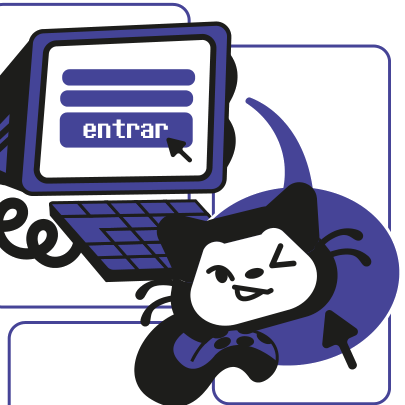
  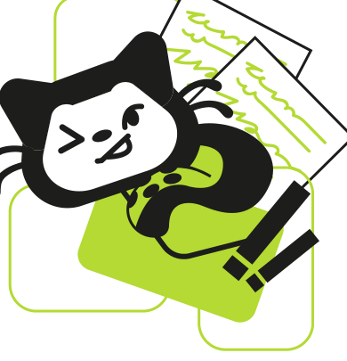
  <br>
  <sub>Distribuído sob a licença MIT (<a href="LICENSE">LICENSE</a>); as dependências de terceiros conservam suas próprias licenças.</sub>
</div>
