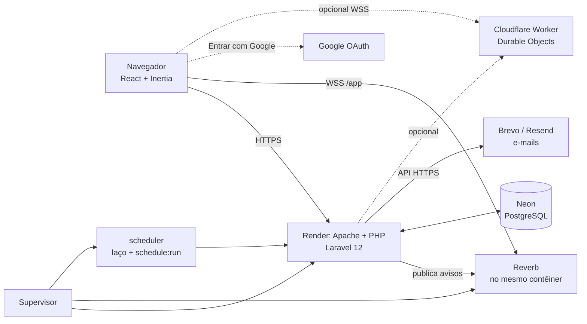

# Estação Commit — visão geral do projeto

Documento para quem acabou de entrar no projeto. Resume o que é o sistema, as tecnologias, a arquitetura, as pastas, o fluxo do jogo e as
regras de segurança. Detalhes ficam nos documentos ligados em cada seção. Voltar ao [índice](README.md) ou ao [README](../README.md).

> **Fonte das regras do jogo:** o documento de regras fechado está em [`JOGO/`](JOGO/) (PDF "Estação Commit — Documento de jogo").
> Este arquivo descreve o **sistema**; em caso de dúvida sobre uma regra do jogo, vale o documento de regras.

---

## 1. O que é o projeto

### 1.1 Objetivo e como funciona o jogo

O **Estação Commit** é um jogo de cartas e tabuleiro online que ensina Git e GitHub a quem está começando. Quatro participantes
(pessoas ou **bots**) disputam uma corrida de 18 etapas. Vence quem **jogar primeiro a Pull Request válida**; a partida termina na hora.

O percurso de cada jogador:

1. **Treinamento:** Git Login → `git clone` → `git checkout -b`.
2. **Quatro ciclos:** Bloco de Código N → `git add .` → `git commit` (para os Blocos 1, 2, 3 e 4).
3. **Envio:** `git pull` → `git push` → **Pull Request**.

Todos começam com **5 cartas**: o Git Login e mais 3 cartas comuns, mais o **Bloco da vez**. Quem não tem a carta de que precisa **troca** uma
(isso conta como a jogada). Há cartas de ataque: *Limpar Credenciais* (reinicia o Treinamento de um adversário) e *Merge Conflict* (o alvo perde a vez).
O jogo é **por turnos**: um jogador por vez, bots inclusive.

### 1.2 Quem usa

- **Jogadores com conta** (e-mail e senha ou Google): perfil público, seguidores, notificações, ranking.
- **Visitantes** (conta temporária): jogam sem cadastro, com nome e avatar; a conta expira por inatividade.
- **Administração:** e-mails em `PROFILE_ADMIN_EMAILS` podem atribuir selos de desenvolvedor.

### 1.3 Principais funcionalidades

Salas para quatro, convites por código/link, bots, tempo real, timeout de vez (25 s), substituição de inativo por bot, ranking
(geral, semanal e mensal), perfis personalizáveis, busca e jogadores recomendados, seguir/deixar de seguir, notificações, tutorial narrativo,
páginas de erro personalizadas e rotinas de limpeza.

### 1.4 Fluxo básico

`Entrar (conta ou visitante)` → `Criar sala ou entrar por convite` → `Aguardar participantes` → `Iniciar partida` → `Jogar` → `Vitória e ranking`.

---

## 2. Tecnologias (as que existem no código)

| Categoria | Tecnologia | Função |
| --- | --- | --- |
| **Frontend** | React 18 + TypeScript 5 | telas, partida, perfis |
| | Inertia.js 2 (+ Ziggy) | entrega páginas React pelo Laravel, sem API duplicada; rotas nomeadas no front |
| | Tailwind CSS 3 | estilos |
| | Framer Motion, Headless UI | animações das cartas, modais e seletores |
| | Vite 7 | build de `public/build` |
| **Backend** | PHP 8.2+ e Laravel 12 | rotas, regras, Eloquent, e-mail, agendador |
| **Banco de dados** | PostgreSQL no **Neon** (produção); SQLite em memória nos testes | contas, salas, partidas, resultados, sessões, cache, notificações; imagens de perfil |
| **Autenticação** | Laravel Sanctum, Socialite | sessões, cookies, Google OAuth; guard próprio `visitor` para contas temporárias |
| **Tempo real** | Laravel Reverb + Echo + pusher-js | WebSocket que apenas **avisa** "recarregue o estado" |
| **Multiplayer (opcional)** | Cloudflare Workers + Durable Objects (`worker/`) | alternativa **desligada por padrão** ao Reverb e ao motor PHP |
| **Infraestrutura** | Docker, Apache (prefork), Supervisor, Render | contêiner único com site, Reverb e agendador |
| **Serviços externos** | Brevo (principal) e Resend (reserva) | e-mails de código e recuperação de senha |
| | Google OAuth 2.0 | "Entrar com Google" (se `GOOGLE_*` estiverem configuradas) |
| **Testes** | PHPUnit 11, Node Test Runner, Vitest (Worker) | regras, segurança, front e paridade PHP × Worker |

Lista de variáveis e serviços: [`DEPLOY/VARIAVEIS-DE-AMBIENTE.md`](DEPLOY/VARIAVEIS-DE-AMBIENTE.md).

---

## 3. Arquitetura

Linhas pontilhadas são **opcionais/desligadas por padrão**: o Worker da Cloudflare só entra com `REALTIME_DRIVER=cloudflare` e/ou
`GAME_ENGINE=cloudflare`; o Google só aparece se `GOOGLE_*` estiverem preenchidas.

- **React + Inertia:** o servidor devolve a página React já com os dados. Atualizações da partida usam *partial reloads* (só `game`,
  `participants`, `hand`).
- **Laravel:** dono do estado do jogo, das regras e da autorização. Roda como PHP no Apache.
- **Neon / PostgreSQL:** guarda tudo (inclusive sessões, cache e locks). Usa pooler; o projeto emprega prepares emulados por causa disso.
- **Reverb:** só emite `room.state.changed` e `user.notices.changed`; **nenhum estado do jogo** vai pelo WebSocket. Há polling de reserva.
- **Render + Docker:** um contêiner com `apache`, `reverb`, `scheduler` e um vigia. Plano gratuito: ~512 MB, 2 processos Apache.
- **Cloudflare (opcional):** avisos (`ChannelHub`) e motor da partida (`MatchRoom`). Ver [`DEPLOY/CLOUDFLARE.md`](DEPLOY/CLOUDFLARE.md).
- **E-mail:** `MAIL_MAILER=resilient` tenta o Brevo e só usa o Resend se o Brevo estiver fora do ar.

Documento técnico completo: [`ARQUITETURA.md`](ARQUITETURA.md).

---

## 4. Estrutura de pastas

| Pasta | O que fica aqui |
| --- | --- |
| `app/Http/Controllers/` | páginas e ações HTTP (salas, partida, perfil, ranking, autenticação) |
| `app/Http/Middleware/` | sessão, cabeçalhos de segurança, Inertia, id da requisição |
| `app/Services/` | regras de negócio: `GameEngine`, `RoomJoinService`, `RoomLeaveService`, `GameInactivityService`, `MatchResults`, e-mail, Cloudflare |
| `app/Support/` | utilitários: identidade de visitante, avatares, bots, `OpsLog`, respostas de erro |
| `app/Models/`, `app/Mail/`, `app/Notifications/`, `app/Rules/` | entidades, e-mails, notificações, validações |
| `app/Console/Commands/` | comandos das rotinas (`games:sweep`, `rooms:expire-waiting`, `rooms:purge-finished`, `guests:prune`) |
| `routes/` | `web.php` (páginas), `auth.php`, `channels.php` (canais), `console.php` (agendador) |
| `resources/js/` | front: `Pages/`, `Components/` (inclui `game/`), `Layouts/`, `lib/` (geometria da mesa, sincronização, toasts) |
| `resources/views/` | `app.blade.php` (casca Inertia) e modelos de e-mail |
| `database/migrations/` | esquema versionado (a fonte oficial); `database/manual-sql/` guarda scripts administrativos documentados |
| `config/` | configurações (`game.php`, `bots.php`, `realtime.php`, `ranking.php`, `players.php`, `achievements.php`, `mail.php`...) |
| `tests/` | `Feature/` e `Unit/` (PHPUnit), `js/` (Node), `parity/` (cenários PHP × Worker) |
| `worker/` | Cloudflare Worker + Durable Objects (motor e canais), com testes próprios |
| `docker/` | Apache (`mpm-tuning`, proxy do Reverb, cache, páginas de erro) e Supervisor |
| `docs/` | esta documentação |
| `public/` | entrada web, `build/` (gerado), imagens das cartas e do tabuleiro, `errors/` (páginas estáticas) |

---

## 5. Fluxo do jogo (o que acontece e onde)

| Etapa | Onde acontece |
| --- | --- |
| **Criação de conta** | Laravel (`RegisteredUserController`). Com `EMAIL_VERIFICATION=true` a conta só é criada depois do código enviado por e-mail |
| **Login** | Laravel: e-mail e senha, ou Google; visitante entra por `/jogar` (cookie próprio) |
| **Criação de sala** | Laravel (`GameRoomController`), com chave de idempotência por tentativa; o criador escolhe a quantidade de bots |
| **Entrada por convite** | Laravel (`RoomJoinService`): valida código, vaga, revogação e validade; visitante cria o perfil temporário e entra |
| **Início da partida** | Laravel (`GameMatchController@start`): exige 4 participantes; motor PHP **ou** Worker, conforme `GAME_ENGINE` |
| **Distribuição das cartas** | motor do jogo: cada jogador recebe o Git Login + 3 cartas comuns e o Bloco 1 |
| **Turnos e ações** | uma ação por vez, na vez de quem joga: `POST` com `action_uuid` (idempotência) e `version` (concorrência) |
| **Bots** | um passo por pedido, na vez do bot, no ritmo do cliente; nunca fora de ordem. Decidem com `BotBrain` (PHP) / `bot.ts` (Worker): só a própria mão e o estado público ([seção 17](ARQUITETURA.md#17-equilíbrio-entre-humanos-e-bots-auditoria-e-simulações)) |
| **Timeout** | vez de humano de 25 s; 3 seguidos removem o jogador e um bot assume o lugar. Relógio do servidor, resolvido também pelo comando agendado |
| **Vitória** | Pull Request válida encerra a partida; resultado gravado em `match_results` (idempotente) |
| **Histórico e ranking** | ranking geral (estatísticas da conta) e semanal/mensal (de `match_results`); só quem tem vitórias aparece |

**Laravel × Worker:** com o motor PHP (padrão), tudo acima roda no Laravel. Com `GAME_ENGINE=cloudflare`, turnos, bots e o relógio da vez
passam para o Durable Object; o Laravel continua com contas, salas, convites, perfis e ranking, e recebe o resultado por *callback* assinado.

Detalhes e regras de timeout/saída: [`ARQUITETURA.md`](ARQUITETURA.md), seção 2.

---

## 6. Segurança e regras importantes

- **Validação no servidor:** o front nunca decide. Cada jogada é validada em `GameEngine` (turno, carta na mão, ordem do percurso, alvo válido).
- **Autorização:** só participantes veem a partida; só o anfitrião inicia/exclui; sala de outra pessoa e sala inexistente respondem **igual** (404).
- **Autenticação:** sessões em cookie HttpOnly; trocar a senha encerra as outras sessões; visitante usa guard próprio com token por hash.
- **Timeout:** relógio do servidor; o tipo do jogador (humano/bot) vem do banco, nunca da requisição.
- **Integridade da partida:** concorrência otimista por `version` e trava de linha; o estado completo (mãos dos outros, baralho) nunca é enviado ao cliente.
- **Ações duplicadas:** `action_uuid` por jogada e `request_id` por criação de sala; repetir devolve o mesmo resultado.
- **Manipulação pelo cliente:** campos sensíveis são ignorados; limites de requisições (`throttle`); mensagens técnicas nunca chegam ao usuário
  (páginas de erro próprias, com código de suporte; detalhes só nos logs).
- **Segredos:** só em variáveis de ambiente; nada em `VITE_*`.

Testes de segurança: `tests/Feature/Security/`.

---

## 7. Desenvolvimento

Requisitos, instalação local, comandos e testes: [`DESENVOLVIMENTO/INSTALACAO-LOCAL.md`](DESENVOLVIMENTO/INSTALACAO-LOCAL.md).
Deploy: [`DEPLOY/RENDER.md`](DEPLOY/RENDER.md). Manutenção: [`MANUTENCAO/GUIA-DE-MANUTENCAO.md`](MANUTENCAO/GUIA-DE-MANUTENCAO.md).
